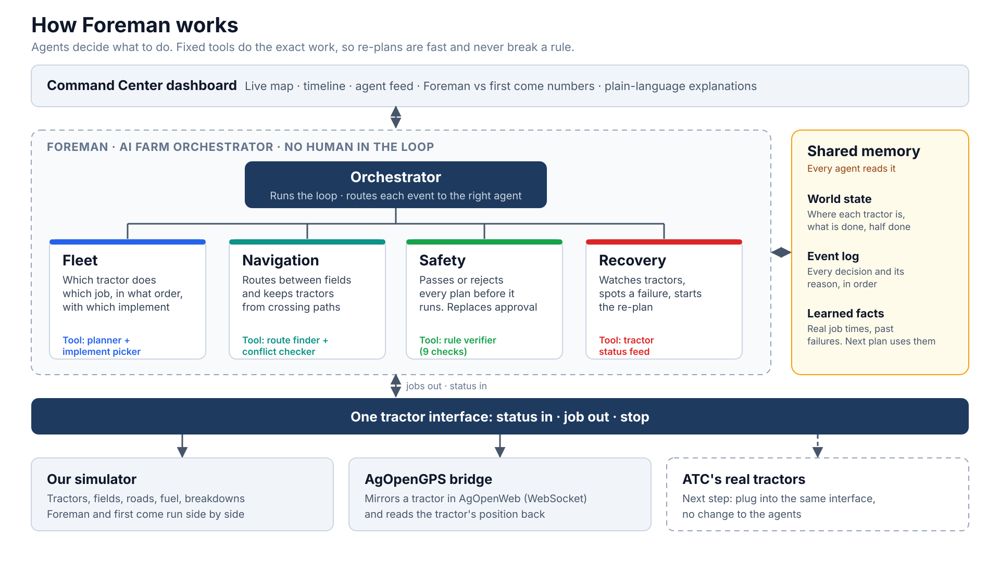

# Foreman

Foreman is an agent layer that assigns jobs to a small fleet of simulated autonomous tractors and re-plans when one breaks down. It is built for the HackAGX "Run the Fleet" challenge by American Tractor Company.

## What Foreman is

A farm manager today decides by phone and whiteboard which tractor does which job, and redoes the plan by hand when a machine breaks. Foreman does that job with no human in the loop. You give it a farm (fields, roads, tractors, implements) and a list of jobs with priorities and deadlines. Five agents pick the right implement for each job, decide which tractor does what and in what order, route the tractors between fields so no two share a field, check every plan against fixed safety rules, and send it to the tractors. When a tractor breaks down, they notice it, keep every bit of finished work, give only the unfinished part to other tractors, and explain the new plan in plain English. We plan the work **between** fields; AgOpenGPS already plans the passes **inside** a field.



## Run it

Needs Python 3.11 (3.10 or newer works).

**Mac / Linux**

```
python3.11 -m venv .venv
source .venv/bin/activate
pip install -r requirements.txt
python -m foreman.server
```

**Windows (PowerShell)**

```
python -m venv .venv
.venv\Scripts\activate
pip install -r requirements.txt
python -m foreman.server
```

If PowerShell refuses to run the activate script, skip it and run `.venv\Scripts\python -m foreman.server` instead.

After the first setup it is one command: `python -m foreman.server`. It starts with the sample farm (`scenarios/farms/sample_farm.json`: 3 tractors, 8 fields, 10 jobs) already loaded.

Open http://localhost:8000 and press **Start**.

Run the tests with `pytest`.

**Load another farm** (any file in `scenarios/` or `scenarios/farms/`, by name):

```
curl -X POST localhost:8000/api/scenario -H "Content-Type: application/json" -d "{\"name\": \"large_farm\"}"
```

## The dashboard and panels

The dashboard at http://localhost:8000 shows the farm map with the tractors moving and each field's progress, the tractor and job lists, Start / Pause / Reset, the simulation speed, and a **Break this tractor** button. Every run is shown side by side with the first come, first served baseline, on the same farm, the same clock, and the same events, so the comparison is fair.

Panels (each also has its own test page):

| Panel | What it shows | Test page |
| --- | --- | --- |
| Numbers | Foreman vs first come, first served: jobs done, on time, working share, travel, idle, km, rule violations. The better side is green, with the gain | http://localhost:8000/panels/numbers.html |
| Decisions | The latest plan change in plain English, the Safety agent's nine checks, and the agent log | http://localhost:8000/panels/decisions.html |
| Why? | Pick a job: which tractor does it and why (implement, power, fuel, route, deadline, priority), why not the others, and every re-plan that moved it | http://localhost:8000/panels/why.html |
| Accuracy | How far the planner's time estimates were from reality, day by day. It says "Learning data appears after day 1" until the learning loop sends data | http://localhost:8000/panels/accuracy.html (demo data: add `?demo=1`) |

## The five agents and shared memory

Agents decide what to do. Tools do the exact work, so plans are fast and never break a rule. The agents are plain Python modules in `foreman/agents/`.

| Agent | Job | Tool it calls |
| --- | --- | --- |
| Orchestrator | Runs the loop and routes each event to the right agents, in order | Event routing table (`ROUTES` in `orchestrator.py`) |
| Fleet | Picks the implement for each job and decides which tractor does which job, in what order | Implement picker, planner |
| Navigation | Routes tractors between fields on the road map and keeps two tractors out of one field | Road map, conflict checker |
| Safety | Passes or rejects every plan before it is sent. This replaces human approval | Rule checker: 9 checks (CLAUDE.md section 12) |
| Recovery | Watches the tractors, spots a breakdown, starts the re-plan with finished work frozen, records the incident | Tractor status feed |

How an event flows: an event comes in (jobs submitted, breakdown, repair, road blocked, priority changed, job added). The Orchestrator sends it to the agents listed for it. For a breakdown that is Recovery, Fleet, Navigation, Safety, then dispatch. A plan that fails a hard safety check is never sent.

**Shared memory, three kinds**
- **World state:** where each tractor is, what is done, what is half done.
- **Event log:** every decision and its reason, in order, append only. Saved as JSON Lines in `runs/event_log.jsonl`. This is the hand-in log.
- **Learned facts:** incidents with a one-line lesson each; measured field speeds are planned for the learning loop.

## Simulation

We use our own simulator. One tractor is planned to be mirrored in AgOpenWeb (see `bridge/`). This section will be updated before hand-in.

**Update:** both parts now exist.
- **Our own simulation** (`foreman/sim.py`) runs every tractor behind one interface (`foreman/adapter.py`: `status`, `dispatch`, `stop`). A referee inside it checks the rules at the moment each job starts and counts any violation, for Foreman and the baseline alike. Hidden "true" field speeds differ from the catalog, so plans meet surprises the way real ones do.
- **AgOpenGPS bridge** (`bridge/agopenweb.py`, by Ahmed) mirrors one Foreman tractor into AgOpenWeb's built-in simulator over its real `/ws` command protocol: it takes control, sends the heartbeat, moves the tractor, and stops it on a breakdown. Start AgOpenWeb with its SIM panel on, start Foreman, then run:

  ```
  python -m bridge.agopenweb --tractor T1 --verbose
  ```

  The other tractors stay on our simulator. Details are in [bridge/README.md](bridge/README.md).

## Tools

All in `tools/`, standard library only.

| Tool | What it does | Example |
| --- | --- | --- |
| `check_farm.py` | Reads any farm file and lists every mistake in plain English (missing nodes, unreachable fields, a job no tractor can do, not enough horsepower, bad `after` links, deadline before release, duplicate ids). Prints `Farm OK` if there are none | `python tools/check_farm.py scenarios/farms/sample_farm.json` |
| `make_farm.py` | Makes random but valid farms of any size. The same seed gives the same farm. Every farm passes the checker | `python tools/make_farm.py --tractors 3 --fields 8 --jobs 10 --seed 1 --out scenarios/farms/random_1.json` |
| `export.py` | Saves the hand-in files from the running server (see below) | `python tools/export.py` |

Farm files in `scenarios/`: `example_farm.json`, and in `scenarios/farms/`: `sample_farm.json` (the demo farm), `small_farm.json` (2 tractors, 5 fields), `large_farm.json` (5 tractors, 15 fields, 25 jobs), `random_1.json`. The format is in CLAUDE.md section 8a.

## Tests

```
pytest
```

The tests cover the planner, simulator, baseline, safety checks, breakdown recovery, explanations, road map, panels, and the tools. `tests/test_rules.py` runs whole days on every farm file, on 20 random farms, and with each tractor breaking at different times, and checks from the outside that:
- a tractor only gets a job if it owns the right implement and has the power to pull it,
- only one tractor works a field at a time,
- no tractor runs out of fuel,
- finished jobs are never redone and finished work is never lost.

## Proof: the numbers

Foreman against first come, first served (the starter dispatcher: take jobs in order, give each to the compatible tractor that frees up first). Same farm, same clock, same events. The baseline obeys the same hard rules, so the comparison is honest.

**The demo farm** (sample farm, one breakdown at 09:30):

| Number | Foreman | First come, first served |
| --- | ---: | ---: |
| Jobs done / on time | 10 / 10 | 10 / 10 |
| Working share of the day | 80.3% | 72.3% |
| Travel time | 90.5 min | 103.7 min |
| Idle time | 0.9 min | 139.7 min |
| Distance driven | 44.2 km | 52.4 km |
| Rule violations | 0 | 0 |

**100 random farms** (2 to 4 tractors, 5 to 12 fields, 6 to 17 jobs, one breakdown each, made with `make_farm.py`):

| Number | Foreman | First come, first served |
| --- | ---: | ---: |
| Jobs done (of 1,134) | 989 | 854 |
| Jobs on time | 902 | 638 |
| Rule violations | 0 | 0 |

Jobs not done are mostly jobs only the broken tractor could do. Foreman reports them as held, with the reason, instead of hiding them.

**196-day sweep** (`python -m foreman.sweep`, by Zayyan): 6 farms, each run quiet and with each tractor breaking at 10 different times. Zero rule violations on every day. Foreman 1,946 jobs on time and 63,637 wasted minutes; baseline 1,343 and 104,355. The few days where the baseline does better are listed honestly under "Known limits" in [CLAUDE.md](CLAUDE.md) section 13.

**Re-plan time** (from event to dispatched plan, measured on the 100 random farms): median 2.2 ms, 95% under 27 ms, slowest 82 ms. The first plan of the day: median 60 ms, slowest 595 ms. On the demo farm the breakdown re-plan takes about 13 ms. It is shown live on the dashboard.

## Hand-in files

| Item | Where |
| --- | --- |
| Code | this repository |
| README | this file |
| Scenario file | `scenarios/farms/sample_farm.json` (copied into `exports/` by the export tool) |
| Event log from the demo run | `exports/log.json` and `exports/log.csv` (also `runs/event_log.jsonl`, written live) |
| Comparison with the baseline | `exports/comparison.md` (readable tables) and `exports/comparison.csv` |

To make them: start the server, run the demo day to the end, then in a second terminal run

```
python tools/export.py
```

It writes everything into `exports/`. Use `--url` if the server is not on `http://127.0.0.1:8000`, and `--out` for another folder.

## Status

This is the Phase 0 skeleton. The server returns fake data from `GET /api/state` in the final shape (CLAUDE.md section 8c). `POST /api/control` and `POST /api/event` are stubs that accept anything and return `{"ok": true}`. `scenarios/example_farm.json` is the pattern for farm files.

**Update (Phase 3):** the Phase 0 note above is history. The server now runs the real planner, simulation, baseline, agents, and safety checks. All endpoints in CLAUDE.md section 8c work, except `GET /api/why`, which is still to come (the Why? panel builds its answer from `/api/state` until then). The learning loop is not built yet, so the accuracy chart shows its "after day 1" message.

## Folders and owners

| Folder | Owner | What goes there |
| --- | --- | --- |
| foreman/ | Zayyan | planner, simulation, agents, memory, safety, server |
| foreman/nav/ | Ahmed | road routing |
| web/ | Ahmed | dashboard page and farm map |
| web/panels/ | Vishva | numbers panel, why panel, accuracy chart |
| bridge/ | Ahmed | AgOpenGPS link |
| scenarios/ | Vishva | farm files |
| tools/ | Vishva | farm checker, random farm maker, exports |
| tests/ | all | each person tests their own part |
| docs/ | Vishva | deck, architecture diagram, README assets |

## Working rules

- Stay inside your own folders.
- Work on your own branch. `main` must always run.
- Merges happen at 2:00, 3:00 and 4:00.
- Small commits with clear messages.
- The shared formats are in CLAUDE.md section 8 and change only by agreement.
- When you finish a task, tick its box in [ROADMAP.md](ROADMAP.md), in your own section only.

Full brief: [CLAUDE.md](CLAUDE.md). Task list by phase: [ROADMAP.md](ROADMAP.md).
