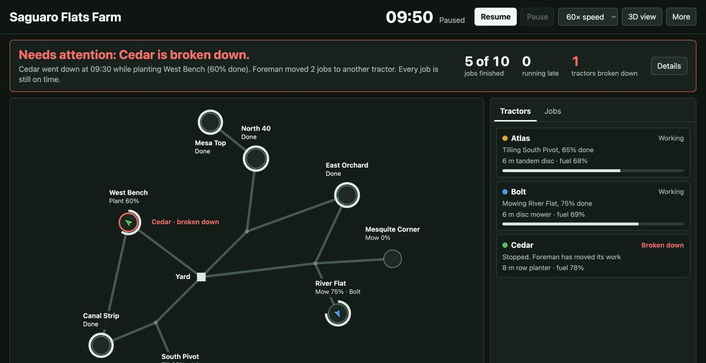
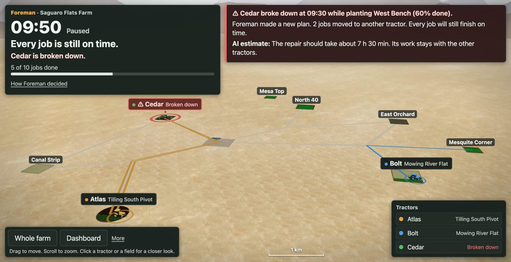
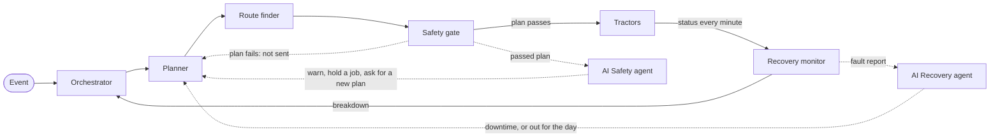
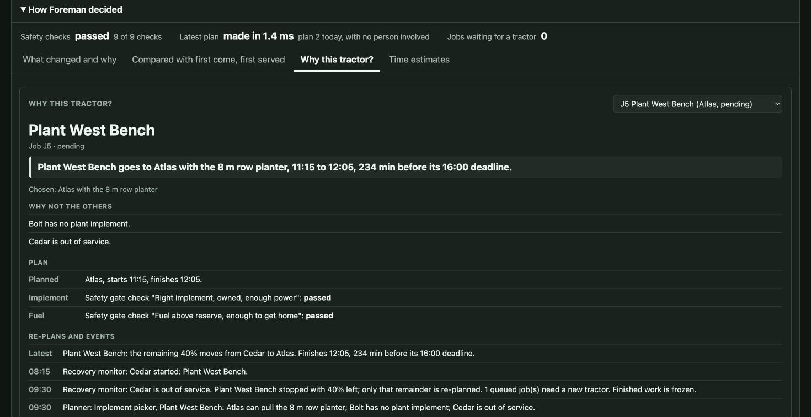

# Foreman

## For the judges

| Hand-in item | Link |
| --- | --- |
| Code | this repository |
| Scenario file | [handin/scenario.json](handin/scenario.json) (the demo farm) |
| Event log from the demo run | [handin/event_log.jsonl](handin/event_log.jsonl) |
| Comparison with the baseline | [handin/comparison.md](handin/comparison.md) |
| How each plan change was explained | [handin/explanations.md](handin/explanations.md) |
| How to run it | [Run it](#run-it) |
| Simulation used | Our own simulation; one tractor can also run in AgOpenWeb ([details](#agopenweb)) |

**Demo day** (sample farm: 3 tractors, 10 jobs, Cedar breaks down at 09:30). Foreman against first come, first served, on the same farm, clock and events. Both obey the same rules.

| | Foreman | First come, first served |
| --- | ---: | ---: |
| Jobs completed | 10 of 10 | 10 of 10 |
| Jobs on time | 10 | 10 |
| Travel | 90.5 min | 103.7 min |
| Idle | 0.9 min | 135.9 min |
| Wasted (travel + idle + yard service) | 201.4 min | 309.6 min |
| Rule violations | 0 | 0 |

**196 test days** (6 farms, each run quiet and with every tractor breaking at 10 different times):

| | Foreman | First come, first served |
| --- | ---: | ---: |
| Jobs completed | 2,119 | 1,824 |
| Jobs on time | 1,946 | 1,343 |
| Travel | 29,043 min | 30,569 min |
| Idle | 5,361 min | 38,203 min |
| Wasted (travel + idle + yard service) | 63,637 min | 104,355 min |
| Rule violations | 0 | 0 |

First come, first served finishes more jobs on time on 2 of the 196 days: the example farm when Cedar breaks at minute 45 or 70. On the demo day it spends less time at the yard (70 min against 110).



## What Foreman is

Foreman decides which tractor does which job, in what order, with which implement.
When a tractor breaks down, it moves the unfinished work to the others within milliseconds and says why in plain words.
No person has to approve anything. Every plan is checked against fixed safety rules before it is sent.

## Run it

Tested on a clean clone with Python 3.11.

```
git clone https://github.com/zessani/hackagx.git
cd hackagx
python3 -m venv .venv
source .venv/bin/activate          # Windows: .venv\Scripts\activate
pip install -r requirements.txt
python -m foreman.server
```

- Dashboard: http://localhost:8000. Press **Start**. The demo farm is loaded.
- 3D view: http://localhost:8000/view3d.html
- **More** on the dashboard: load another farm, break down a tractor, close a road.
- The two AI agents need a model token in `.env` (not in the repo). Without it, everything runs on the rules alone.
- Tests: `pytest`. Hand-in folder again: `python -m foreman.handin --test-days`. The 196 test days: `python -m foreman.sweep`.



## How it works



**Rule-based core** (`foreman/roles/`). Five roles, no AI:

| Role | Job |
| --- | --- |
| Orchestrator | Sends each event to the right roles, in order |
| Planner | Which tractor does which job, in what order, with which implement |
| Route finder | Routes between fields; two tractors never work one field at once |
| Safety gate | Checks every plan against 9 fixed rules. A plan that fails is never sent |
| Recovery monitor | Spots a breakdown from the status feed and starts a new plan, keeping finished work |

**Two AI agents** (`foreman/ai_recovery.py`, `foreman/ai_safety.py`). They only add caution and never assign jobs. The rule-based plan is sent first; their answer is applied when it arrives (15 second limit, any failure falls back to the rules).
- AI Recovery agent: reads a fault report and estimates the downtime, or says the tractor is out for the day. The planner holds work for the tractor only if waiting still meets every deadline with 30 minutes to spare.
- AI Safety agent: reviews each plan the safety gate passed. It can warn, hold a job, or ask for one new plan, which must pass the safety gate again. It remembers its earlier warnings and what happened after.

**Learning and self-tune.**
- Learning: Foreman compares each finished job with its estimate and learns each field's real speed. The estimate error falls from 8.9% on day 1 to 1.1% on day 5 (Time estimates on the dashboard).
- Lessons: every breakdown leaves a lesson with the real outcome, which the AI Recovery agent reads next time.
- Self-tune: at the end of a day Foreman replays past days with nearby planner settings. It adopts a setting only if it wins on the days it tuned on and also on days it did not see. Safety margins can never be tuned.

<a id="agopenweb"></a>**AgOpenWeb.** Every tractor sits behind one interface (`status`, `dispatch`, `stop`), so any tractor can run in AgOpenWeb while the others stay simulated:

```
FOREMAN_AGOPENWEB_URLS="T1=ws://127.0.0.1:5174/ws" python -m foreman.server
```

Details: [ARCHITECTURE.md](ARCHITECTURE.md) and [bridge/README.md](bridge/README.md).

## The challenge's must-haves

- [x] **Take a job list from an operator.** Jobs come from the farm file ([handin/scenario.json](handin/scenario.json)); a job can also be added or reprioritised while the day runs.
- [x] **Assign compatible tractors** (implement, power, fuel, deadlines). Checked on every plan by the safety gate; 0 violations on all 196 test days ([handin/comparison.md](handin/comparison.md)).
- [x] **Show progress on a dashboard or map.** [Dashboard](docs/screenshots/dashboard-breakdown.jpg) and [3D view](docs/screenshots/3d-view-breakdown.jpg).
- [x] **Recover from a breakdown** with no conflicting assignments and no lost or repeated work. Only the unfinished part is moved; see 09:30 in [handin/event_log.jsonl](handin/event_log.jsonl).
- [x] **Explain the new plan in plain language.** [handin/explanations.md](handin/explanations.md), and "Why this tractor?" for any job:



## Known limits

- First come, first served does better on 2 of the 196 test days on on-time jobs, and on 5 days on wasted minutes. The day plan does not hedge against a breakdown.
- Foreman spends more time at the yard swapping implements than the baseline on the demo day (110 min against 70).
- Two tractors may meet on the same road; only sharing a field is ruled out. A road rule is designed but not finished.
- In AgOpenWeb a tractor moves and Foreman follows it, but it does not yet work a real field: that needs a field and guidance line prepared in AgOpenWeb. Only one AgOpenWeb copy runs per computer.
- A planner step that hedges against breakdowns has a mixed effect: on 596 days it changed 80 day plans, 15 ended better and 35 worse (`python -m foreman.resilience_report`).
- Self-tune found a gain on 1 of 4 farms tested, in wasted minutes only.
- All results are from simulation. Weather and terrain are not modelled.

## Team

Zayyan, Ahmed, Vishva.
