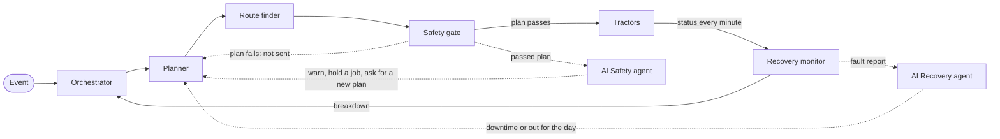

# Foreman

Foreman runs a small fleet of autonomous tractors with no human in the loop. It assigns jobs, picks the implement, sends each tractor to work, and makes a new plan by itself when a tractor breaks down or a road closes. Built for the HackAGX "Run the Fleet" challenge (American Tractor Company).

Rules decide and check every plan. Two AI agents add caution. Nothing waits on the AI.

## Run it

Python 3.10 or newer.

```
python -m venv .venv
source .venv/bin/activate        # Windows: .venv\Scripts\activate
pip install -r requirements.txt
python -m foreman.server
```

Open http://localhost:8000 and press **Start**. The sample farm (3 tractors, 8 fields, 10 jobs) is loaded. A second copy for testing: `python -m foreman.server --port 8010`.

The AI agents need a model token in `.env`. Without it, everything still runs on the rules.

Tests: `pytest`

## Simulation

Our own simulation (`foreman/sim.py`) runs every tractor behind one interface: `status`, `dispatch`, `stop`. A referee inside it counts any rule broken, for Foreman and the baseline alike.

AgOpenWeb: any tractor can run in AgOpenWeb instead, while the others stay simulated:

```
FOREMAN_AGOPENWEB_URLS="T1=ws://127.0.0.1:5174/ws" python -m foreman.server
```

The tractor moves in AgOpenWeb and Foreman follows it. It does not yet work a real field there: that needs a field and guidance line prepared in AgOpenWeb.

## How it works



| Role | AI? | Job |
| --- | --- | --- |
| Orchestrator | No | Sends each event to the right roles |
| Planner | No | Which tractor does which job, in what order, with which implement |
| Route finder | No | Routes between fields; two tractors never share a field |
| Safety gate | No | Checks every plan against fixed rules before it is sent |
| Recovery monitor | No | Spots a breakdown and starts a new plan, keeping finished work |
| AI Recovery agent | Yes | Reads a fault report and estimates the downtime |
| AI Safety agent | Yes | Reviews a passed plan. Can only add caution |

Memory: an event log of every decision (`runs/event_log.jsonl`), learned field speeds, and lessons from past faults. Details: [ARCHITECTURE.md](ARCHITECTURE.md).

## Results

Against first come, first served (the starter dispatcher), on the same farm, clock and events. Both obey the same rules.

**Demo day** (sample farm, Cedar breaks down at 09:30):

| | Foreman | First come, first served |
| --- | ---: | ---: |
| Jobs on time | 10 of 10 | 10 of 10 |
| Travel | 90.5 min | 103.7 min |
| Idle | 0.9 min | 135.9 min |
| Wasted (travel, idle, yard) | 201.4 min | 309.6 min |
| Rules broken | 0 | 0 |

**196 test days** (6 farms, each quiet and with every tractor breaking at 10 different times, `python -m foreman.sweep`):

| | Foreman | First come, first served |
| --- | ---: | ---: |
| Jobs on time | 1,946 | 1,343 |
| Wasted minutes | 63,637 | 104,355 |
| Rules broken | 0 | 0 |

The baseline finishes more jobs on time on 2 of the 196 days. These are listed in [CLAUDE.md](CLAUDE.md) section 13.

A new plan after a breakdown takes about 4 ms on the demo farm. It is shown live on the dashboard.

## Hand-in

`python -m foreman.handin` writes the `handin/` folder: the scenario file, the event log from the demo run, the comparison with the baseline, and the plan explanations.
